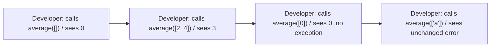
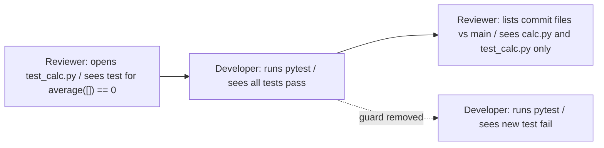

# QT-14 stories and storyboards

Parent story: [QT-14](https://ncoder.atlassian.net/browse/QT-14), Make average([]) return 0 instead of raising ZeroDivisionError.

Build order: QT-18 first (the code change), then QT-19 (the test that pins it and the pytest run).

## Sub-tasks

| Key | Summary | Points | Depends on |
|-----|---------|--------|------------|
| QT-18 | Return 0 for average([]) in calc.py | 1 | none |
| QT-19 | Cover average([]) == 0 in test_calc.py and run pytest | 1 | QT-18 |

## QT-18: Return 0 for average([]) in calc.py

Story line: As a developer calling `average()` in `calc.py`, I want an empty list to return `0`, so that callers do not get a `ZeroDivisionError` for empty input.

Acceptance criteria:
- Given `calc.py` defines `average()`, when `average([])` is called, then it returns `0` and raises no exception.
- Given `calc.py` defines `average()`, when `average([2, 4])` is called, then it returns `3`.
- Given a one-element list `[0]`, when `average([0])` is called, then it returns `0` and raises no exception (boundary).
- Negative: given a non-numeric list such as `["a"]`, when `average` is called, then behaviour is unchanged from before this story.

Out of scope:
- Changing `discount()` or any other function in `calc.py`.
- Input validation beyond the empty-list guard.
- Writing the test file (QT-19).

### Storyboard

Criteria shown: 1 (frame A), 2 (frame B), 3 (frame C), 4 (frame D).
Not shown: none.

## QT-19: Cover average([]) == 0 in test_calc.py and run pytest

Story line: As a team member reviewing the change, I want a test that pins `average([]) == 0` and a passing pytest run, so that the empty-list behaviour cannot regress silently.

Acceptance criteria:
- Given `test_calc.py` exists, when a new test asserts `average([]) == 0`, then the test is present in `test_calc.py`.
- Given the new test is present, when pytest runs, then all tests pass, including the existing ones.
- Given `average([2, 4])` is called, when the existing or new test checks it, then the result is `3` (regression).
- Negative: given the guard from QT-18 is removed, when pytest runs, then the new test fails.
- Given the commit, when changed files are listed against `main`, then only `calc.py` and `test_calc.py` appear.

Out of scope:
- Editing `calc.py` (QT-18).
- Tests for functions other than `average()`.
- Changing pytest configuration or CI.

### Storyboard

Criteria shown: 1 (frame A), 2 (frame B), 3 (frame B, existing tests), 4 (negative branch D), 5 (frame C).
Not shown: none.

## Not yet verified

- Code: `calc.py` and `test_calc.py` could not be read (GitHub returns 404; the branch does not resolve). The `average()` behaviour and the pytest command are taken from the Jira text.
- Sub-task parent link: checked in the Jira read after creation (see the record of this step).
